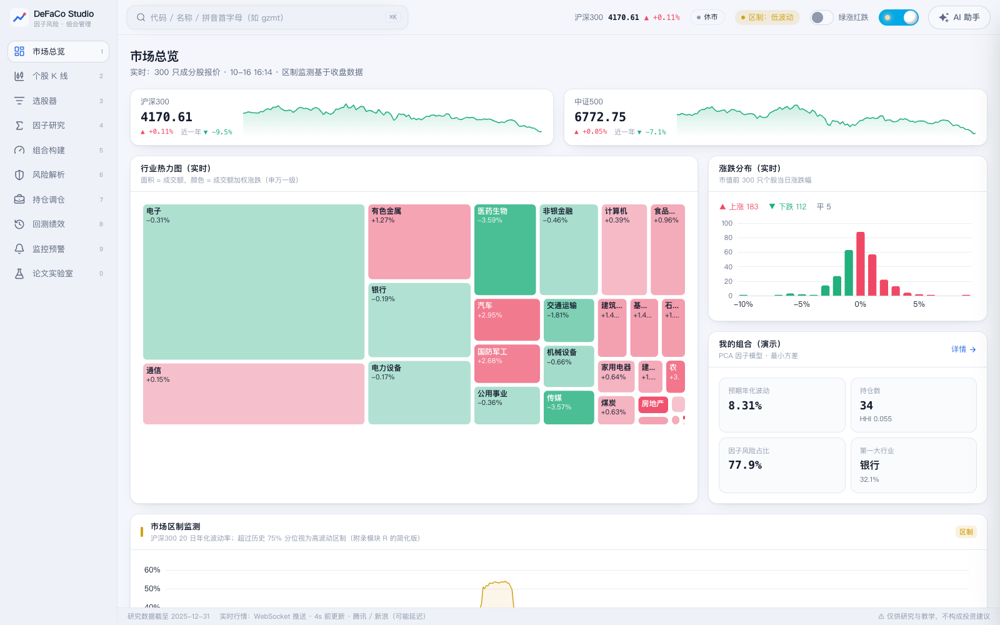
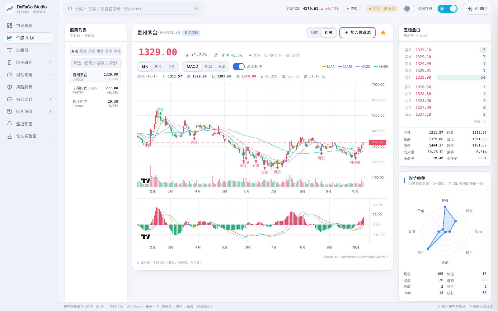
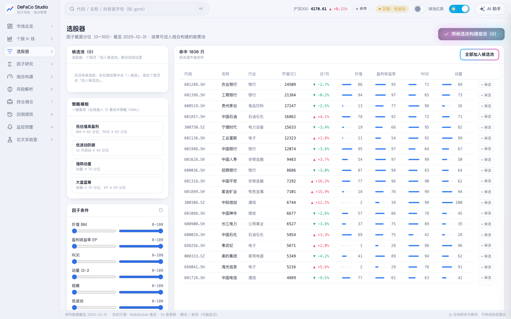
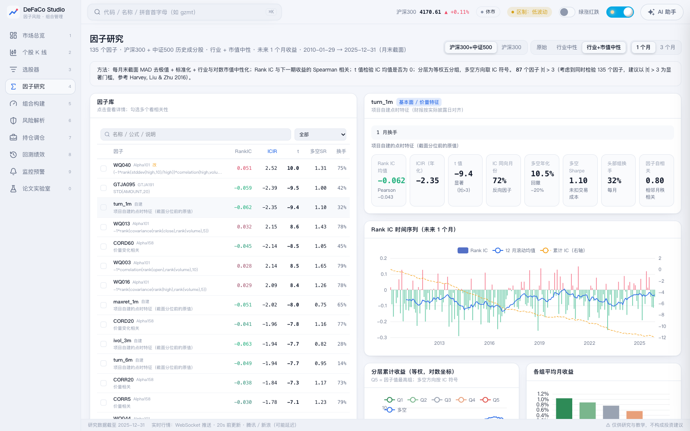
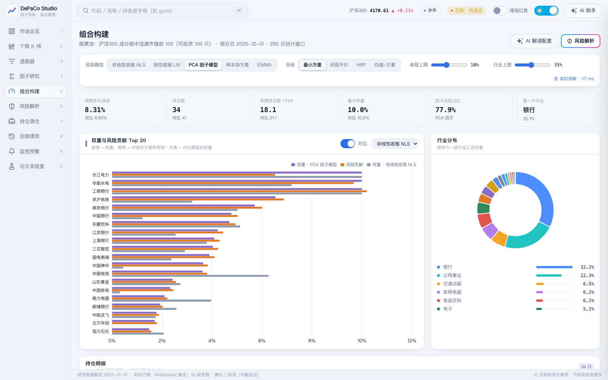
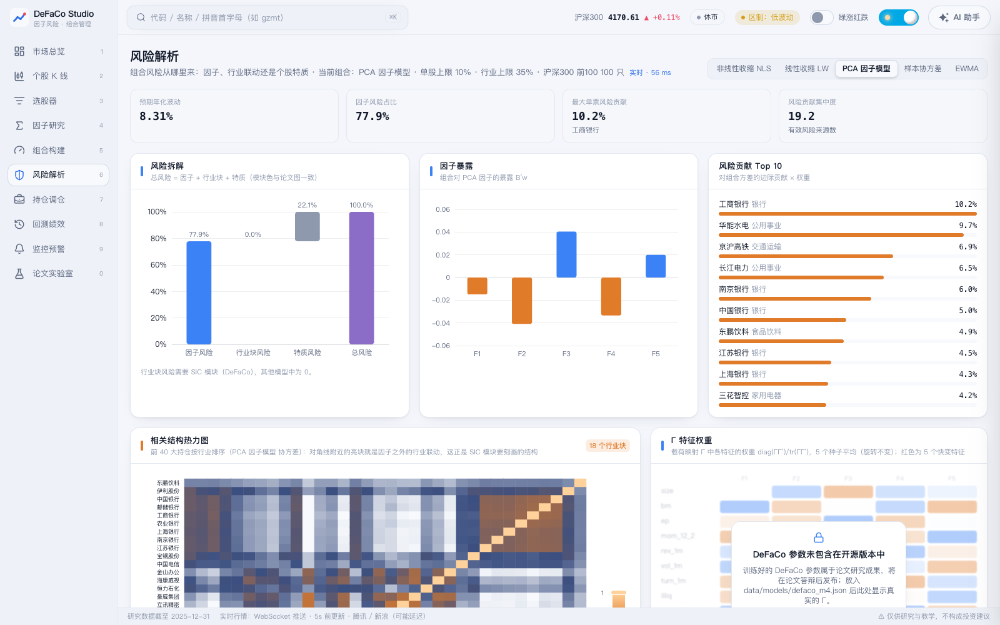
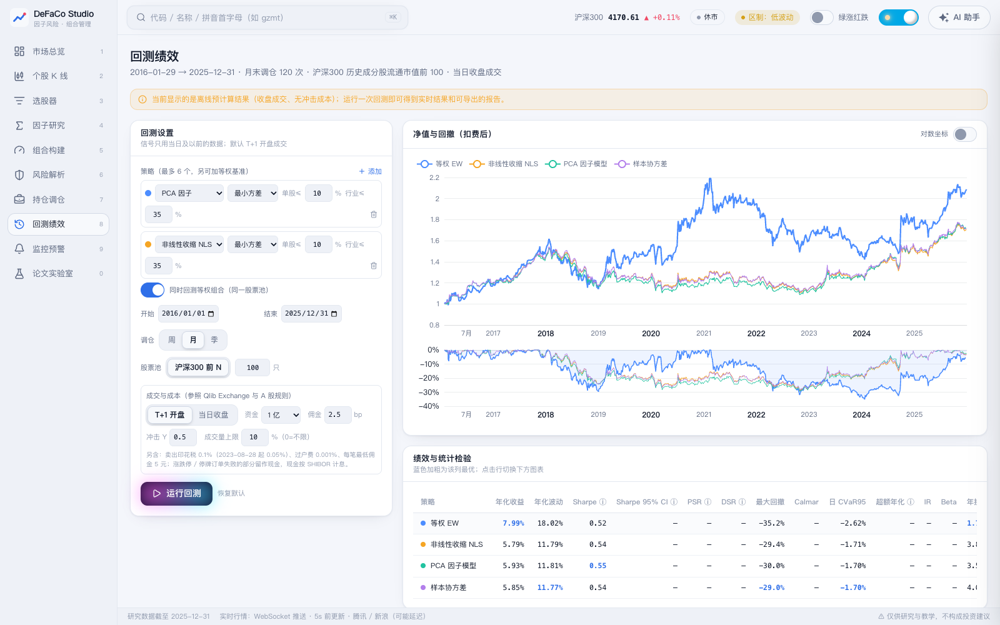
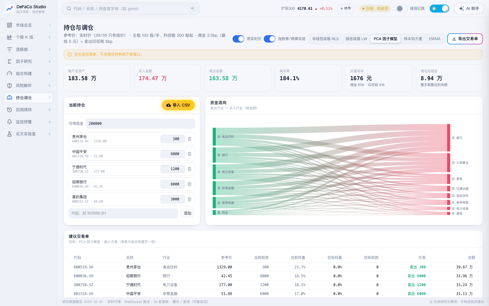
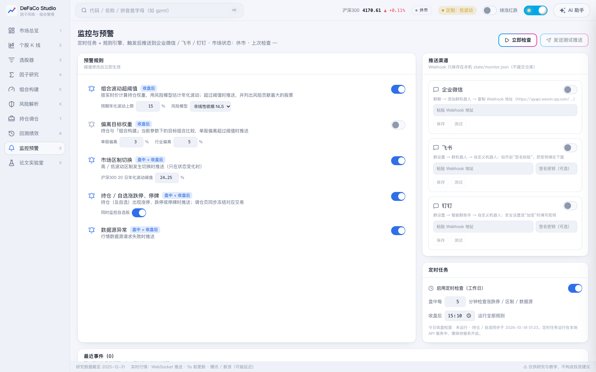

<div align="center">

# DeFaCo Studio

**A 股因子风险与组合管理工作台 · An A-share factor-risk and portfolio-management workbench**

行情 · 选股 · 因子研究 · 风险模型 · 组合优化 · 风险解析 · 调仓 · 回测 · 监控推送 · AI 投研助手

[](LICENSE)


</div>

> **仅供研究与教学，不构成投资建议。** 本项目只生成交易单，**不连接任何券商下单接口**。行情来自免费公开接口，可能延迟；研究数据仅供个人研究，公开部署前请确认各数据源的使用条款。

DeFaCo Studio 是毕业论文《Decision-Focused, Turnover-Aware Factor Covariance for Minimum-Variance Portfolios: Evidence from China's A-Share Market》的配套系统：把论文研究的组件（风险模型、A 股交易规则下的最小方差优化、换手与交易成本）做成可交互的工具，论文实验与本系统共用同一个计算引擎 `quantkit`。

> **关于论文模型 DeFaCo**：DeFaCo 的实现代码（`quantkit/riskmodels/defaco.py`）已开源，但**训练好的模型参数和论文实验结果属于尚未答辩的研究成果，不包含在本仓库中**，将在论文答辩后发布。在此之前，系统中的 DeFaCo 选项与「论文实验室」页会自动隐藏或给出说明，其余功能完全可用。

---

## 目录

- [功能](#功能)
- [截图](#截图)
- [🤖 用 AI 一键安装（推荐）](#-用-ai-一键安装推荐)
- [手动安装](#手动安装)
- [研究数据](#研究数据)
- [AI 投研助手配置](#ai-投研助手配置)
- [架构与目录](#架构与目录)
- [测试](#测试)
- [常见问题](#常见问题)
- [许可证](#许可证)

## 功能

| 模块 | 能做什么 |
|---|---|
| 市场总览 | 指数走势、行业热力图（面积 = 成交额，颜色 = 涨跌）、涨跌分布、波动区制监测 |
| 个股 K 线 | 分时 / 日周月 K、MACD / KDJ / RSI、K 线形态标注、五档盘口、因子画像；全 A 股 5,705 只证券按代码 / 名称 / **拼音首字母**搜索（`Ctrl/Cmd + K`） |
| 选股器 | 策略模板 + 因子分位条件筛选，结果一键加入候选池，候选池可直接送去组合构建 |
| 因子研究 | 135 个因子（24 个自建点时特征 + Qlib Alpha158 70 个 + WorldQuant Alpha101 27 个 + 国泰君安 191 中 14 个）；MAD 去极值、行业 / 市值中性化、Rank IC 与 Newey–West t 值、五分组、IC 衰减、换手、因子相关 |
| 组合构建 | **实时求解**（约 50–150 ms）：风险模型（非线性收缩 NLS、线性收缩、PCA 因子模型、样本协方差、EWMA）× 目标（最小方差、风险平价、HRP、Bayes–Stein 均值–方差）× 单股 / 行业上限；与另一模型并排对比 |
| 风险解析 | 风险拆解（因子 / 行业块 / 特质）、因子暴露、风险贡献 Top 10、按行业排序的相关结构热力图 |
| 持仓调仓 | 录入或导入 CSV 持仓 → 按整手生成建议交易单；用实时行情处理**涨停不买、跌停不卖、停牌不动**；资金流向桑基图；导出交易单 |
| 回测绩效 | T+1 开盘成交、按板块的涨跌停（主板 10%、ST 5%、科创板 / 创业板 20%、北交所 30%）、停牌、退市、成交量上限、最低佣金 5 元、印花税、过户费、平方根冲击成本；PSR / DSR、Sharpe 置信区间；HTML 报告与 CSV 导出 |
| 监控预警 | 5 条规则（组合波动、偏离目标、区制切换、涨跌停 / 停牌、数据源异常）+ 定时任务，推送到企业微信 / 飞书 / 钉钉 |
| AI 投研助手 | DeepSeek 驱动；14 个只读工具调用引擎数据；**每个数字自动核验出处**，合规检查（不给目标价、不给买卖指令）；个股深度研报（多空分析师 + 风控主编） |
| 论文实验室 | 展示论文方法与消融实验（论文结果答辩后发布） |

## 截图

| 市场总览 | 个股 K 线 |
|---|---|
|  |  |
| **选股器** | **因子研究** |
|  |  |
| **组合构建（实时优化）** | **风险解析** |
|  |  |
| **回测绩效** | **持仓调仓** |
|  |  |
| **监控预警** | |
|  | |

## 🤖 用 AI 一键安装（推荐）

把下面整段 prompt 复制给你的 AI 编程助手（Claude Code、Cursor、GitHub Copilot Agent、Codex、Windsurf 等能执行命令的工具），它会检查环境、安装依赖、跑测试并启动系统；需要下载大量数据或填写密钥时会先征求你的同意。

```text
请帮我在本机安装并运行开源项目 DeFaCo Studio（https://github.com/zse04152005-del/defaco-studio）。
这是一个 A 股因子风险与组合管理工作台：Python 后端（FastAPI + 计算引擎 quantkit）+ React 前端。
请按下面的步骤执行。每一步完成后检查输出；出错时先阅读报错、自行排查并修复，修复了什么要告诉我，不要为了绕过错误而修改项目代码。

1. 检查环境：git；Python 3.11 或 3.12；Node.js ≥ 20.19（含 npm）；推荐用 uv 管理 Python（https://docs.astral.sh/uv/）。
   如果缺少某个工具，先告诉我缺什么、打算怎么装，得到我同意后再安装。
   如果我用的是 Windows，请在 WSL 中操作，或把下面的 .venv/bin/python 换成 .venv\Scripts\python.exe，并分别启动后端和前端（见第 7 步）。

2. 克隆仓库并进入目录：
   git clone https://github.com/zse04152005-del/defaco-studio.git
   cd defaco-studio

3. 创建虚拟环境并安装后端依赖：
   uv venv --python 3.12 .venv
   uv pip install --python .venv/bin/python -e "packages/quantkit[dev]" -r services/api/requirements.txt
   （没有 uv 时：python3 -m venv .venv && .venv/bin/pip install -e "packages/quantkit[dev]" -r services/api/requirements.txt）

4. 运行测试，确认安装正确（不需要行情数据；个别依赖数据的测试会跳过）：
   .venv/bin/python -m pytest packages/quantkit services/api/tests -q

5. 安装前端依赖：
   cd web && npm ci && cd ..

6. 配置：cp .env.example .env
   AI 投研助手需要 DeepSeek API Key。先问我要不要配置：如果我给你 Key，只把它写进 .env 的 DEEPSEEK_API_KEY=，
   不要在回复里复述、不要提交到 git、不要发送到任何其他地方；如果我不需要，就在 .env 里设置 ASSISTANT_ENABLED=0。

7. 启动：bash scripts/dev.sh
   （后端 http://127.0.0.1:8000，前端 http://127.0.0.1:5173；Windows 无 bash 时分两个终端运行：
    .venv/bin/uvicorn app.main:app --app-dir services/api --port 8000  和  cd web && npx vite --port 5173）
   然后验证：curl http://127.0.0.1:8000/api/market/status 返回 JSON；在浏览器打开 http://127.0.0.1:5173 能看到「市场总览」。
   此时系统用仓库自带的演示数据运行，实时行情来自公开接口。

8. 可选——下载研究数据（实时组合优化、回测、因子研究需要）：先告诉我这一步会从 BaoStock / AkShare 下载
   2009–2025 年沪深 300 与中证 500 历史成分股的行情、行业和财报数据，耗时较长（可能需要数小时），可以中断后重新运行续传。
   得到我同意后依次运行：
   .venv/bin/python scripts/ingest.py
   .venv/bin/python scripts/build_features.py
   .venv/bin/python scripts/build_alpha_factors.py
   完成后重启 scripts/dev.sh。

规则：不要连接任何券商或交易接口；本项目仅供研究和教学。
全部完成后，给我一个简短总结：安装了什么、哪些步骤跳过了、如何启动和停止系统、遇到并解决了哪些问题。
```

## 手动安装

**环境要求**：git、Python 3.11 / 3.12、Node.js ≥ 20.19、（推荐）[uv](https://docs.astral.sh/uv/)。macOS / Linux 可直接使用；Windows 建议使用 WSL。

```bash
git clone https://github.com/zse04152005-del/defaco-studio.git
cd defaco-studio

# 后端：引擎 quantkit + API 服务
uv venv --python 3.12 .venv
uv pip install --python .venv/bin/python -e "packages/quantkit[dev]" -r services/api/requirements.txt

# 前端
cd web && npm ci && cd ..

# 配置（AI 助手的 Key 等，可选）
cp .env.example .env

# 启动：后端 :8000 + 前端 :5173
bash scripts/dev.sh
```

浏览器打开 <http://127.0.0.1:5173>。没有研究数据时，页面使用仓库自带的演示数据（`web/public/demo-data/`），实时行情、K 线和 AI 助手照常工作。

## 研究数据

实时组合优化、风险解析、回测、因子研究需要本地研究数据（约 1–2 GB，保存在 `data/`，不进仓库）：

```bash
.venv/bin/python scripts/ingest.py              # 历史成分股、日线、行业、财报、指数（BaoStock 为主，AkShare 补充）
.venv/bin/python scripts/build_features.py      # 月末点时特征（24 个）
.venv/bin/python scripts/build_alpha_factors.py # 因子库（Alpha158 / Alpha101 / GTJA191）
```

- 每一步都可以中断后重新运行续传；`ingest.py --shard k/n` 可以开多个进程并行下载。
- BaoStock 不可用时，可先用冒烟数据集体验（**当前成分股，有幸存者偏差，不可用于研究结论**）：
  `.venv/bin/python scripts/ingest.py --members current --bar-source sina --steps members bars industry financials index consolidate`
- 日期范围、股票池、成本等参数在 `configs/default.yaml`。
- 数据源：[BaoStock](http://baostock.com)、[AkShare](https://github.com/akfamily/akshare)（新浪、东方财富等）；实时行情：腾讯 / 新浪公开接口。均仅供个人研究使用。

## AI 投研助手配置

1. 在 `.env` 中填写 `DEEPSEEK_API_KEY`（`.env` 已被 git 忽略，状态接口也不会返回 Key）。
2. 可选：`DEEPSEEK_MODEL`、`DEEPSEEK_MODEL_PRO` 指定模型；`ASSISTANT_ENABLED=0` 完全关闭助手。
3. 发送给模型服务的只有问题、页面上下文和引擎汇总数据，**不含持仓股数与金额**；回答中的每个数字都会在工具结果中核验出处，界面显示「数字核验 x/y」。

监控推送的 Webhook（企业微信 / 飞书 / 钉钉）可以在「监控预警」页填写（保存在本地 `state/monitor.json`），也可以写在 `.env`。

## 架构与目录

```
Web 前端（React 19 + TypeScript + Vite + Tailwind；ECharts、TradingView Lightweight Charts）
   │  REST · SSE · WebSocket
服务层（FastAPI）：实时优化、回测与因子任务、定时任务与推送、AI 助手（工具 + 护栏）
   │
引擎层 quantkit：点时数据面板、风险模型注册表、优化器、回测器、因子库与检验
   │
数据源：BaoStock、AkShare、腾讯 / 新浪实时行情、DeepSeek API
```

| 路径 | 内容 |
|---|---|
| `packages/quantkit/` | 计算引擎：数据管道、点时特征、风险模型（样本、线性 / 非线性收缩、EWMA、POET、PCA / 潜在因子、IPCA、Barra 式、SIC 行业块残差、DeFaCo）、优化器、回测、绩效与检验 |
| `services/api/` | FastAPI 服务：行情、组合优化、回测、因子研究、监控、AI 助手 |
| `web/` | 前端 |
| `scripts/` | 数据下载与特征构建、演示数据导出、`dev.sh` |
| `configs/` | 日期、股票池、成本等配置 |
| `docs/images/` | README 截图 |

新增风险模型只需在 `quantkit/riskmodels/` 实现 `RiskModel` 接口（`fit` / `covariance` / `explain`）并用 `@register("name")` 注册，再加入 `services/api/app/portfolio.py` 的 `MODELS`，所有页面即可使用。

## 测试

```bash
.venv/bin/python -m pytest packages/quantkit services/api/tests -q   # 引擎与服务（约 120 个测试）
cd web && npx tsc --noEmit                                           # 前端类型检查
```

测试覆盖：协方差正定、权重约束、无前视、点时财报对齐、涨跌停 / 成交量上限 / T+1 / 退市 / 成本、回测与研究引擎一致性、助手的数字核验与合规检查等。

## 常见问题

- **端口被占用**：`dev.sh` 使用 8000 和 5173 端口，先关闭占用它们的程序。
- **「研究数据未就绪」**：还没有下载研究数据，见[研究数据](#研究数据)；其余页面使用演示数据照常工作。
- **看不到 DeFaCo 选项 / 论文实验室没有内容**：论文模型参数和实验结果尚未公开，将在论文答辩后发布。
- **AI 助手不可用**：检查 `.env` 中的 `DEEPSEEK_API_KEY`，修改后重启后端。
- **行情显示延迟或缺失**：公开行情接口可能限流或变动，稍后重试；非交易时间显示最近收盘价。

## 许可证

[MIT](LICENSE) © 2026 Shien Zhang。第三方组件及其许可证见 [THIRD_PARTY_NOTICES.md](THIRD_PARTY_NOTICES.md)。
